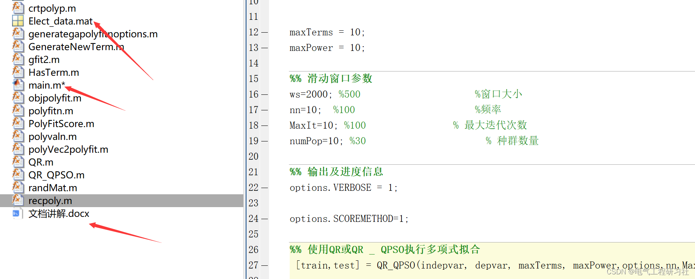

# Matlab | Comparison of Particle Swarm Optimization with Mixed Nonlinear Regression and Autoregressive Techniques Based on Time Series Prediction

​  
This article is organized as follows: ⛳️⛳️⛳️Table of Contents: 1. Overview 2. Particle Swarm Optimization in a Dynamic Environment 3. A Comparative Study of Particle Swarm Optimization with Time Series Prediction and Autoregressive Techniques 4. MATLAB Code Implementation 5. Final Thoughts
Typically, real-world time series prediction problems are dynamic. If the characteristics of such time series merely represent conceptual shifts, then a passive learning method becomes ideal, adjusting model parameters continuously whenever new data patterns arrive to cope with changing uncertainties. This work integrates quantum-inspired particle swarm optimization designed for dynamic environments to address conceptual shifts, and employs least squares approximation techniques or nonlinear autoregressive models to predict time series. Furthermore, this paper also conducts experimental evaluations and comparative studies on the performance of the proposed models. The results indicate that the nonlinear autoregressive model outperforms the least squares approximation model and several recent models implemented in hybridization, as well as the given dataset.
Time series data is often associated with various exogenous factors, such as economic fluctuations, weather conditions, and special circumstances. These factors require high nonlinearity and complex patterns, making prediction a challenging task. Typically, real-world time series forecasting problems are dynamic. If the characteristics of this time series merely represent conceptual shifts, then a passive learning method becomes ideal. It constantly adjusts model parameters whenever new data patterns arrive, to address the changing uncertainties. Therefore, the passive learning method maintains an updated model at all times.
Autoregression (AR) models are a classic predictive technique commonly used in time series modeling, particularly valuable when there is a high degree of aggregation and a large amount of data, or when the need for explicit separation of seasonal indices is not required. The advantages of AR models include strong scalability, composed of simple features but unable to predict complex sequences, especially when conceptual shifts occur frequently.
Predictive models based on nonlinear regression, where training data is used once to induce a prediction model and then tested on new instances, have been successfully used in literature. Best parameter estimation for these nonlinear regression-based models typically uses classical techniques such as QR decomposition or metaheuristics. However, classical techniques often get trapped in local minima. Therefore, metaheuristics like Particle Swarm Optimization (PSO) have been considered as alternatives.
The standard PSO in dynamic environments faces the following issues: loss of diversity and outdated memory. Fundamentally, when the value of the personal best pBest of particles becomes irrelevant to the current popular environment due to changes in the optimal solution, outdated memory occurs.
There are several PSOs designed specifically for dynamic environments in the literature. Charged PSO is an ideal choice for dynamic optimization. Thus, it has been adopted in this work.
The quantum-inspired PSO (QPSO), proposed in 2004, is generally known as quantum-inspired (QPSO), inspired by principles and concepts of quantum computing (Branke, 2012; Blackwell and Bentley, 2002). In QPSO, the quantum cloud consists of neutral particles and charged particles. Charged particles (quantum particles) seek new solutions, while neutral particles improve the current solution using position and velocity equations.
3. Comparison of Particle Swarm Optimization with Mixed Nonlinear Regression and Autoregressive Techniques Based on Time Series Forecasting
The hybrid techniques designed for time series forecasting include QPSO and classical techniques (QR decomposition or NARX). Based on the results obtained, the following conclusions are drawn: QPSO optimizes the model structure induced by QR decomposition or NARX, and the proposed technique indeed optimizes the induced predictive model, adjusting the prediction model in response to changes in the conceptual transition environment, thereby improving prediction performance. Two hybrid techniques have been proposed, and for a given dataset, the NARX-QPSO technique outperforms the QR-QPSO technique. The NARX-QPSO technique brings competitive performance to several state-of-the-art models/techniques for the given dataset. Future work could consider combining NARX-QPSO with EMD to create an integrated technique that captures inherent nonlinearity in time series data. The obtained hybrid techniques can be evaluated across various applications, such as financial data and renewable energy. A detailed empirical analysis could be conducted to determine how NARX-QPSO performs compared to QR-QPSO in predicting the time of conceptual shift for a given dataset. Additionally, based on experience, it is important to consider the search capabilities of these techniques and how to measure the cost of prediction errors.
4. Matlab Code Implementation
This paper only showcases the main function code; all code is available in:
clc;\nclear;\nclose all;\n\n%% Load data\nload Elect_data\nindepvar =pop(:,1:end-1);                       % Independent variable\ndepvar =pop(:,end);                             % Variable\n\n\n\nmaxTerms = 10; \nmaxPower = 10; \n\n%% Sliding window parameters\nws=2000; %500                     %window size\nnn=10;  %100                      %frequency\nMaxIt=10; %100                % Maximum number of iterations\nnumPop=10; %30                      % Population size\n\n%% Output and progress information\noptions.VERBOSE = 1;\n\noptions.SCOREMETHOD=1;\n\n%% Perform polynomial fitting using QR or QR_QPSO\n [train,test] = QR_QPSO(indepvar, depvar, maxTerms, maxPower,options,nn,MaxIt,numPop,ws); \n\n  
5. Endnotes: The references to theoretical literature are from online sources, and if any infringement occurs, please contact the blogger for removal.

## Images

<!-- PAYMENT_BLOCK -->

## Get this dataset

- Payment link (Stripe): [Buy now](https://buy.stripe.com/3cs8yP7sY87d0vu9AB)
- Payment QR code: 

<!-- /PAYMENT_BLOCK -->
